# Library Management System

Name: Dadiso Mondiwa (H250655C) 

## Class diagram

```mermaid
classDiagram
    class Borrowable {
        <<interface>>
        +borrow(Member)
        +giveBack()
    }
    class LibraryItem {
        <<abstract>>
        -String id
        -String title
        -boolean available
        +loanPeriodDays() int
        +toCsv() String
    }
    class Book {
        -String author
    }
    class Dvd {
        -int minutes
    }
    class Member {
        -String id
        -String name
        -List loans
        +MAX_LOANS = 3
    }
    class Loan {
        -String itemId
        -String memberId
        -LocalDate dueOn
        +isOverdue(LocalDate) boolean
    }
    class Library {
        -Map items
        -Map members
        +borrow(memberId, itemId) Loan
        +giveBack(itemId) Loan
        +listOverdue(LocalDate) List
        +searchByTitle(String) List
    }
    class LibraryStore {
        +save(Library, Path)
        +load(Path) Library
    }
    class ItemNotAvailableException
    class MemberLimitExceededException

    Borrowable <|.. LibraryItem
    LibraryItem <|-- Book
    LibraryItem <|-- Dvd
    Library o-- LibraryItem
    Library o-- Member
    Member o-- Loan
    LibraryStore ..> Library
    Library ..> ItemNotAvailableException
    Library ..> MemberLimitExceededException
```

## Report

**Design.** LibraryItem is an abstract class holding the shared data (id, title, availability). Book and Dvd extend it and give their own loan period (14 and 7 days), so the same call `item.loanPeriodDays()` behaves differently (polymorphism). The Borrowable interface describes what can be borrowed and returned.

**Encapsulation.** All fields are private. Constructors validate input through one shared helper, so an item or member can never be created with a blank name.

**Error handling.** Two checked exceptions, ItemNotAvailableException and MemberLimitExceededException, stop invalid borrowing (maximum 3 loans per member). The menu catches them and prints a clear message instead of crashing.

**Collections and streams.** Items and members are kept in maps keyed by id. Searching by title and listing overdue loans use stream pipelines.

**Persistence.** On exit the program writes items.csv, members.csv and loans.csv. On start it reads them back and re-attaches the loans, so data survives between runs.

**Testing.** LibraryDemo runs every rule without typing. LibraryApp lets a user try the menu.